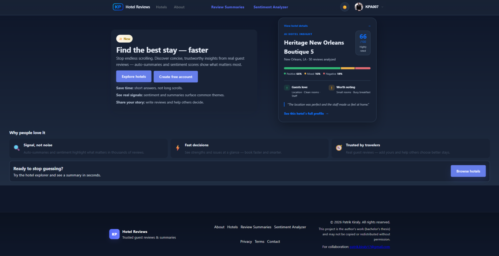
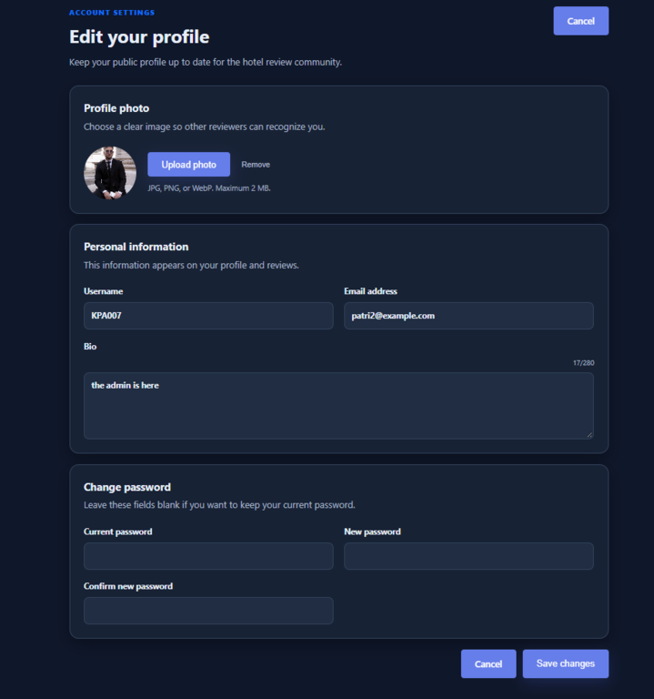
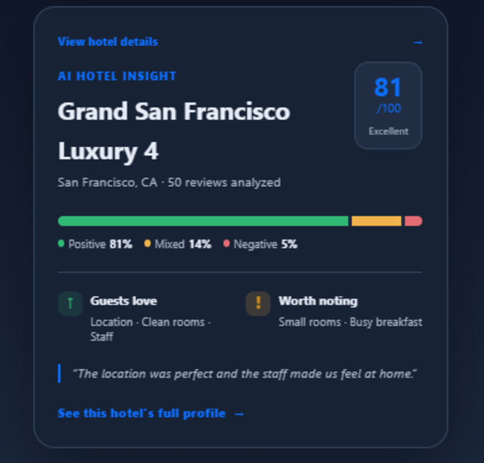
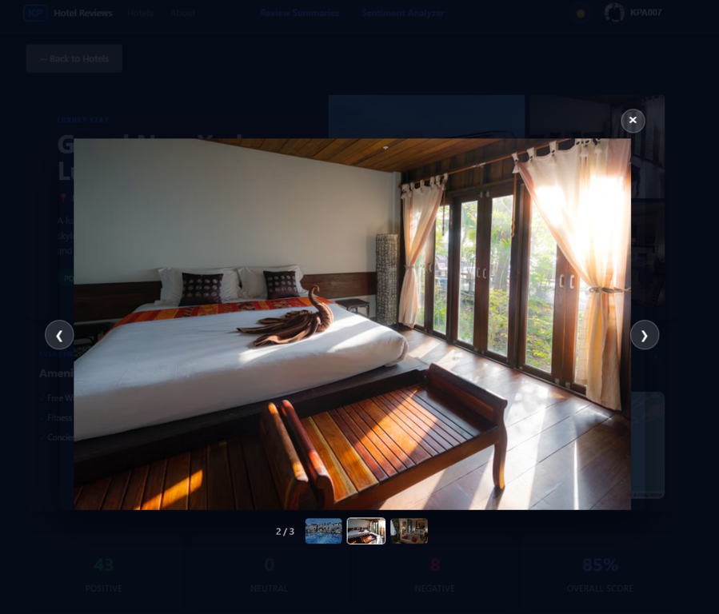
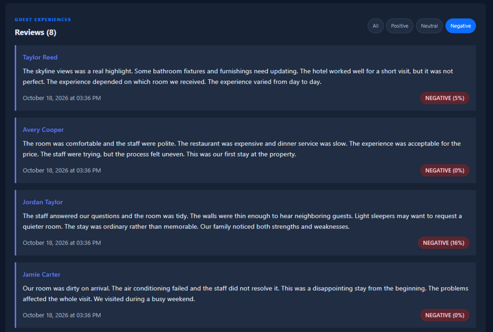

# 🎓 Thesis Project: Hotel Review AI Sentiment Analyzer

<p align="center">
  <strong>An AI-powered full-stack platform for analyzing sentiment in hotel reviews.</strong>
</p>

<p align="center">
  <a href="https://github.com/kp-patrik/thesis-hotel-review-ai-sentiment-analyzer">
    
  </a>
  
  
  
  
</p>

<p align="center">
  
</p>


## 📌 Project Overview

This repository contains my thesis project: a hotel-review management platform with an integrated artificial-intelligence sentiment analyzer.

The application accepts natural-language hotel reviews, processes them with a transformer-based NLP model, and returns a sentiment label, confidence value, and normalized score. The results are stored and presented through hotel-level dashboards, review history, and summary views.

The project demonstrates how an AI model can be integrated into a practical web application rather than used as an isolated experiment.

### Academic project caption

> **Hotel Review AI Sentiment Analyzer** is a full-stack thesis project that designs and implements an AI-assisted tool for classifying and analyzing sentiment in hotel reviews. The system combines a React user interface, a FastAPI REST API, a SQLAlchemy persistence layer, and the Hugging Face `distilbert-base-uncased-finetuned-sst-2-english` transformer model to provide automated sentiment scoring, review analytics, and hotel-level insight.

## 🖼️ Application Preview

### Landing page


### Hotel discovery

| Hotel listing | Hotel details, gallery, amenities, and map |
|---|---|
|  |  |

### AI analysis and summaries

| Sentiment analyzer | Generated review summary |
|---|---|
|  |  |

### Reviews and account experience

| Review submission | Authentication | Profile and dark mode |
|---|---|---|
|  |  |  |

### 🌟 Optional feature showcase

These screenshots are not required for the core gallery, but they make the
repository more expressive by highlighting some of the application's most
interactive features.

<table>
  <tr>
    <td align="center" width="33%">
      <strong>Rotating hotel insight</strong><br><br>
      <br><br>
      <sub></sub><br><br>
      <code>00-landing-page.png</code>
    </td>
    <td align="center" width="33%">
      <strong>Interactive photo carousel</strong><br><br>
      <br><br>
      <sub>Open a room or exterior image with thumbnails, navigation controls, and the image counter visible.</sub><br><br>
      <code>08-photo-carousel.png</code>
    </td>
    <td align="center" width="33%">
      <strong>Review sentiment filters</strong><br><br>
      <br><br>
      <sub>Show the hotel review list with a positive, neutral, or negative filter selected.</sub><br><br>
      <code>09-review-filters.png</code>
    </td>
  </tr>
</table>

<p align="center">
  <em>Tip: Capture these optional views in the same browser size and theme as
  the main gallery for a consistent visual presentation.</em>
</p>

Do not include passwords, email addresses, API keys, tokens, local file paths, or personal information in screenshots.

### Screenshot presentation tips

- Use `1366 × 768` or wider for the main gallery.
- Use dark mode for the primary set and light mode for one comparison screenshot.
- Capture the photo carousel with the selected image centered and its thumbnails visible.
- Capture the analyzer after a result has loaded, including the sentiment label and score.
- Capture summaries after generation completes, including the positive/negative breakdown.
- Use demo accounts and fictional content only.

## ✨ Main Features

- **AI sentiment analysis** using a Hugging Face DistilBERT transformer model.
- **Interactive sentiment analyzer** for testing custom review text.
- **Hotel catalog** with descriptions, locations, review counts, and aggregate sentiment.
- **Rich hotel detail pages** with category-based photo galleries, a click-to-open carousel, amenities, embedded location maps, and review filters.
- **Curated development data** with 100 hotels and 50 realistic, hotel-specific reviews per hotel, using varied positive, mixed, and negative sentiment profiles instead of placeholder text.
- **Review submission** with automatic sentiment classification and score calculation.
- **Review summaries** generated from representative reviews across the full hotel dataset, with factual positive/negative sentiment breakdowns.
- **User authentication** with password hashing, JWT access tokens, email verification, and password-reset flows.
- **Editable user profiles** with username, email, bio, profile photo, and protected password changes.
- **Persistent light/dark theme** across the application, including the analyzer, summaries, profiles, reviews, and hotel pages.
- **Dynamic landing-page hotel insight** featuring a different well-rated hotel on reload and a direct link to its detail page.
- **Persistent storage** using SQLite and SQLAlchemy.
- **REST API documentation** generated automatically by FastAPI and available through Swagger UI.
- **Responsive React interface** with protected pages, loading states, error handling, and reusable components.

## 🧠 AI Sentiment Analysis

The backend uses:

```text
Model:      distilbert-base-uncased-finetuned-sst-2-english
Provider:   Hugging Face Transformers
Task:       Natural-language sentiment classification
Output:     POSITIVE or NEGATIVE label, confidence, and normalized 0–1 score
```

Example API request:

```bash
curl -X POST "http://localhost:8000/analyze" \
  -H "Content-Type: application/json" \
  -d "{\"text\":\"The room was clean and the staff were wonderful.\"}"
```

Example response:

```json
{
  "text": "The room was clean and the staff were wonderful.",
  "label": "POSITIVE",
  "score": 0.99,
  "confidence": 0.98
}
```

The model is downloaded and cached by Transformers on its first use. The first backend startup may therefore take longer than subsequent starts.

## 🛠️ Technology Stack

| Layer | Technologies |
|---|---|
| Frontend | React 18, Vite, React Router, Axios, Recharts |
| Backend | Python, FastAPI, Uvicorn, Pydantic |
| AI/NLP | Hugging Face Transformers, DistilBERT, PyTorch |
| Data layer | SQLAlchemy ORM, SQLite |
| Authentication | JWT, PBKDF2 password hashing |
| Quality checks | ESLint, Python compilation, production build checks |

## 🗂️ Project Structure

```text
.
├── backend/
│   ├── main.py                 # FastAPI routes and authentication
│   ├── database.py             # SQLAlchemy engine and database models
│   ├── models.py               # Database operations and review statistics
│   ├── sentiment.py            # Transformer sentiment analyzer
│   ├── summarization.py        # Review summarization
│   ├── migrations.py           # Schema creation and upgrades
│   ├── requirements.txt        # Python dependencies
│   └── data/                   # Seed data
├── frontend/
│   ├── src/
│   │   ├── components/         # Reusable UI components
│   │   ├── pages/              # Application pages
│   │   ├── services/           # API clients
│   │   └── auth/               # Authentication state
│   ├── package.json
│   └── vite.config.js
├── docs/
│   └── screenshots/            # GitHub README screenshots
├── DEVELOPMENT.md
└── README.md
```

## 🚀 Getting Started

### Prerequisites

- Python 3.12 or newer
- Node.js 18 or newer
- Git
- Enough disk space for the downloaded transformer models

### 1. Clone the repository

```bash
git clone https://github.com/kp-patrik/thesis-hotel-review-ai-sentiment-analyzer.git
cd thesis-hotel-review-ai-sentiment-analyzer
```

### 2. Configure and start the backend

Windows PowerShell:

```powershell
cd backend
python -m venv venv
.\venv\Scripts\Activate.ps1
pip install -r requirements.txt
Copy-Item .env.example .env
```

Edit `backend/.env` and replace `SECRET_KEY` with a unique value. Then initialize and start the API:

```powershell
python migrations.py create
python migrations.py seed
uvicorn main:app --reload --port 8000
```

To rebuild the local development database with the curated 100-hotel dataset and 5,000 meaningful reviews with varied hotel sentiment averages while preserving registered users:

```powershell
python seed_data.py
```

Backend URLs:

- API: <http://localhost:8000>
- Swagger documentation: <http://localhost:8000/docs>

### 3. Configure and start the frontend

In a second terminal:

```powershell
cd frontend
npm install
Copy-Item .env.example .env.local
npm run dev
```

Open <http://localhost:5173>.

The default frontend configuration expects the backend at `http://127.0.0.1:8000`. Change `VITE_API_BASE_URL` in `frontend/.env.local` if the API runs elsewhere.

### Development email behavior

When SMTP settings are not configured, verification and password-reset messages are printed in the backend terminal. This is intentional for local development; do not use console-generated tokens as a production email workflow.

## 🔌 API Overview

| Method | Endpoint | Purpose | Authentication |
|---|---|---|---|
| `GET` | `/` | API health message | Public |
| `GET` | `/hotels` | List hotels and aggregate sentiment | Public |
| `GET` | `/hotels/{hotel_id}` | Get hotel details and reviews | Public |
| `POST` | `/analyze` | Analyze custom text | Public |
| `POST` | `/register` | Create a user account | Public |
| `POST` | `/login` | Obtain a JWT access token | Public |
| `GET` | `/me` | Get the authenticated user | JWT |
| `PUT` | `/me` | Update username, email, bio, profile photo, or password | JWT |
| `POST` | `/reviews` | Submit and analyze a review | JWT |
| `POST` | `/summarize` | Summarize hotel reviews | Public |

### Review and summary behavior

- Review authors are always taken from the authenticated account; clients cannot choose a different reviewer name.
- The sentiment model is binary (`POSITIVE` or `NEGATIVE`). The interface uses aggregate mixed/neutral views for review statistics, but the model itself does not provide a native neutral class.
- Summary generation samples reviews across the entire hotel review set instead of truncating only the first reviews. This helps preserve negative feedback for hotels with lower aggregate scores.
- Hotel gallery photos currently use stable Unsplash image URLs selected by hotel category. Replace them with locally hosted or licensed production assets before deployment if required.

## ✅ Verification

The project has been checked with:

```bash
# Python syntax
python -m compileall -q backend build_diploma_document.py

# Dependency audit
python backend/check_dependencies.py

# Frontend lint and production build
cd frontend
npm run lint
npm run build
```

## 🔐 Configuration and Privacy

- Never commit `backend/.env`, `frontend/.env.local`, credentials, tokens, or private email settings.
- Use `backend/.env.example` and `frontend/.env.example` as configuration templates.
- The local SQLite database and virtual environments are intentionally ignored by Git.
- Use a strong, unique `SECRET_KEY` outside development.

## 🎓 Thesis Context

This implementation can be discussed in a thesis through the following areas:

1. Natural-language processing and transformer-based classification.
2. Converting model confidence into application-level sentiment scores.
3. Integrating AI inference into a REST API.
4. Persisting and aggregating user-generated review data.
5. Designing a usable interface for interpreting model results.
6. Evaluating limitations, including language coverage, domain shift, and model bias.

## 🔭 Future Improvements

- Add a labeled hotel-review evaluation dataset and project-specific metrics.
- Support multilingual sentiment analysis.
- Add automated tests for API routes, authentication, and model output handling.
- Add time-series sentiment charts and exportable thesis evaluation reports.
- Add CI checks for linting, builds, and backend tests.

## 👤 Author

**Patrik**

- GitHub: [@kp-patrik](https://github.com/kp-patrik)
- Repository: [thesis-hotel-review-ai-sentiment-analyzer](https://github.com/kp-patrik/thesis-hotel-review-ai-sentiment-analyzer)

## 📄 License

This project is licensed under the [MIT License](./LICENSE).

The MIT License applies to this project's original source code. Third-party
dependencies, the DistilBERT model, and external Unsplash images remain subject
to their respective licenses and terms. Confirm image licensing before using
the project in production.
